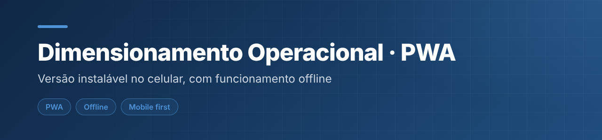
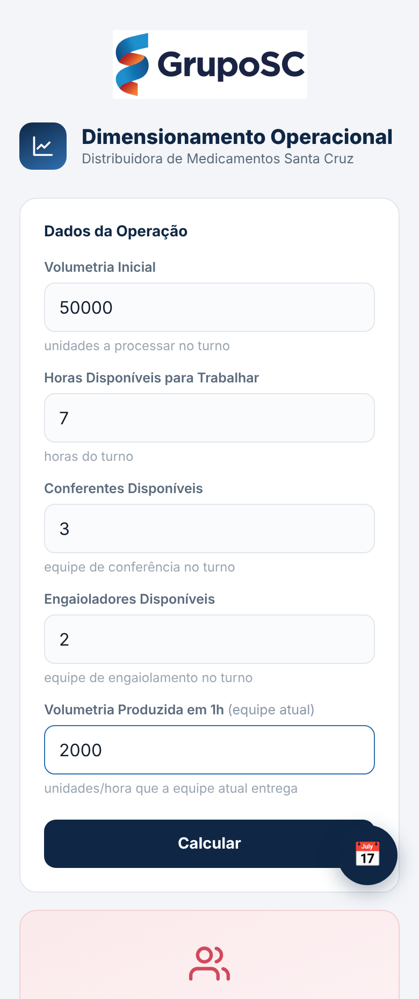

  

<h1 align="center">Dimensionamento Operacional · Versão PWA</h1>

Versão instalável no celular da calculadora de dimensionamento operacional, com funcionamento offline e dados salvos no próprio aparelho.

  

     

---

## 📌 Sobre

Mesma lógica da [calculadora de dimensionamento operacional](https://github.com/orezzende/dimensionamento-operacional), empacotada como **PWA** (Progressive Web App) para ser usada no celular como se fosse um aplicativo.

## 🖼️ Demonstração

  
   Versão mobile: dados da operação e performance da equipe

## ✨ Funcionalidades

- Cálculo da equipe necessária e medidor de performance
- Painéis de Conferência de Notas e de Engaiolamento, com metas editáveis
- Programador do dia seguinte
- **Instalável** na tela inicial (Android e iPhone) e **funciona offline** via Service Worker
- Dados salvos localmente, no aparelho de cada usuário

## 🛠️ Tecnologias

`HTML5` · `CSS3` · `JavaScript` · `Service Worker` · `Web App Manifest`

## ▶️ Como usar

Abra a demo no celular. No Chrome (Android): menu ⋮ → **Instalar app**. No Safari (iPhone): **Compartilhar → Adicionar à Tela de Início**. Depois de aberto uma vez, funciona offline.

Não precisa instalar nada nem rodar servidor: é só HTML, CSS e JavaScript.

## 🚀 Publicar no GitHub Pages

1. Envie todos os arquivos do repositório (`index.html`, `sw.js`, `manifest.webmanifest`, `icon-192.png`, `icon-512.png`).
2. Em **Settings → Pages**, escolha *Deploy from a branch*, branch `main`, pasta `/ (root)`, e salve.
3. Em cerca de 1 minuto o app fica disponível em `https://SEU-USUARIO.github.io/santa-cruz/`.

## 📝 Observações

Para atualizar a versão publicada, substitua o `index.html` e aumente o identificador de cache no `sw.js` (por exemplo, de `sc-v1` para `sc-v2`).

---

## 👤 Autor

**Daniel da Silva Rezende** — estudante de Engenharia de Software e Análise e Desenvolvimento de Sistemas.

